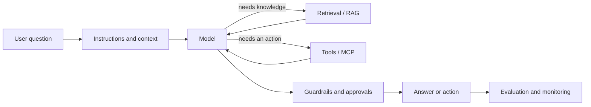

# Applied AI Field Guide

A portable, plain-language reference for learning how modern AI applications work. Use it to study on the go, prepare for interviews, or quickly revisit a concept without searching through scattered notes and screenshots.

The guide is written from an analytics perspective: how to turn governed data, business definitions, and operational metrics into reliable AI decision-support tools.

## Start here

**[Open the complete study guide](STUDY_GUIDE.md)** for a concise overview of the full applied AI system.

Then use these topic notes when you want more detail:

| Topic | What you will understand | Study page |
|---|---|---|
| Foundations | Models, tokens, context windows, temperature, and system boundaries | [Foundations](modules/01-foundations.md) |
| Prompts and context | How instructions and supplied information shape an answer | [Prompts and context](modules/01-foundations.md#prompt-and-context-engineering) |
| Tools and structured output | How an AI system returns dependable data and calls software | [Tools and structured output](modules/02-tools-structured-outputs.md) |
| Embeddings and RAG | How systems search trusted information and answer with evidence | [RAG](modules/02-rag.md) |
| MCP | How AI applications connect to tools and data through a common protocol | [MCP](modules/03-mcp.md) |
| Agents | How models, tools, state, routing, and approvals form a workflow | [Agents](modules/04-agents.md) |
| Evaluation | How to measure quality before and after release | [Evaluation](modules/05-evaluation.md) |
| Security and governance | How to protect data, constrain actions, and preserve accountability | [Security](modules/06-security-deployment.md) |
| Production and monitoring | How to operate a dependable AI application | [Production](modules/07-production.md) |

## The system in one picture

The model is one component. A useful AI product also needs trusted context, controlled tools, predictable outputs, evaluation, and operational safeguards.

## A simple study method

For each topic:

1. Read the plain-language overview and mental model.
2. Explain it aloud without using technical jargon.
3. Work through the analytics example.
4. Answer the review questions from memory.
5. Follow the official references when you want implementation detail.
6. Build one small example and record what you learned in [LEARNING_LOG.md](LEARNING_LOG.md).

## Interview-ready capstone story

The material leads toward an **Operational Intelligence Agent** that:

- combines global and regional metrics in one view;
- uses Python to create a governed JSON data layer;
- retrieves definitions and operating guidance with citations;
- uses controlled tools to identify the dimensions driving a metric change;
- explains results through an agent, custom GPT, or HTML dashboard;
- evaluates answer quality, tool use, latency, and cost;
- requires human approval for consequential actions.

This connects existing analytics experience with applied AI: the goal is faster, traceable diagnosis and better decisions, rather than a chatbot for its own sake.

## Practice and progress

- [Interactive progress tracker](index.html)
- [12-week build roadmap](ROADMAP.md)
- [Learning log](LEARNING_LOG.md)

## Trusted references

- [OpenAI developer learning resources](https://developers.openai.com/learn/agents)
- [OpenAI Agents guide](https://developers.openai.com/api/docs/guides/agents)
- [OpenAI Agents SDK](https://developers.openai.com/api/docs/guides/agents/sdk)
- [OpenAI tools guide](https://developers.openai.com/api/docs/guides/tools)
- [OpenAI MCP guide](https://developers.openai.com/api/docs/guides/tools-connectors-mcp)
- [Model Context Protocol documentation](https://modelcontextprotocol.io/)
- [LangChain learning resources](https://docs.langchain.com/oss/python/learn)
- [LangSmith evaluation concepts](https://docs.langchain.com/langsmith/evaluation-types)

## Author

**Asteway Kebede** — Data Analytics & Applied AI  
[LinkedIn](https://www.linkedin.com/in/kasteway/) · [GitHub](https://github.com/kasteway)
