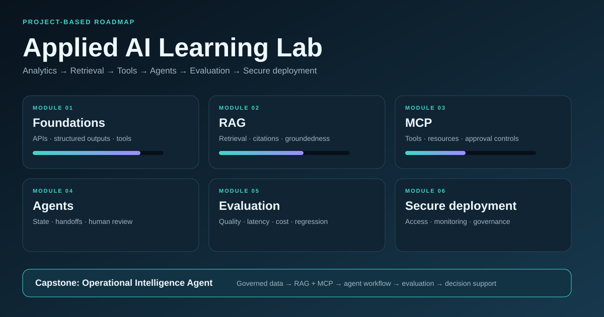

# Applied AI Learning Lab

A practical, project-based roadmap for moving from analytics and business intelligence into applied AI solutions. The curriculum focuses on building reliable systems that connect business data, retrieval, tools, agents, and user-facing decision support.



## Career objective

Build the skills to design and deliver applied AI solutions from end to end:

> business problem → governed data → retrieval and tools → agent workflow → evaluation → secure deployment → measurable value

This roadmap complements experience in SQL, Python, BigQuery, Tableau, Power BI, forecasting, machine learning, operational scorecards, custom GPTs, Copilot agents, and interactive dashboards.

## Learning tracks

| Track | Core outcome | Portfolio evidence |
|---|---|---|
| Foundations | Explain tokens, context, embeddings, structured outputs, tool calling, and system boundaries | Small API exercises with documented tradeoffs |
| RAG | Build a grounded assistant over trusted documents | Source-cited knowledge assistant with retrieval evaluation |
| MCP | Expose governed tools and resources through a standard protocol | Read-only operational metrics MCP server |
| Agents | Coordinate tools, state, handoffs, approvals, and recovery | Multi-step analyst agent with human review |
| Evaluation | Measure retrieval, tool selection, correctness, latency, and cost | Repeatable test dataset and scorecard |
| Security and governance | Apply least privilege, approval gates, logging, and data controls | Threat model and control checklist |
| Deployment and observability | Package, monitor, and improve a working application | Deployed demo with traces and runbook |

## Recommended 12-week path

### Phase 1 — Build the foundation (Weeks 1–2)

- [ ] Understand LLM inputs, outputs, context windows, tokens, and temperature
- [ ] Call an API from Python and handle errors, retries, timeouts, and rate limits
- [ ] Use structured outputs to return validated JSON
- [ ] Build and document one function tool
- [ ] Learn basic prompt design and context engineering
- [ ] Protect secrets with environment variables

**Deliverable:** A command-line KPI explainer that accepts structured metrics and returns a validated diagnostic summary.

### Phase 2 — Retrieval-Augmented Generation (Weeks 3–4)

- [ ] Ingest and clean a small document collection
- [ ] Split documents and preserve useful metadata
- [ ] Create embeddings and a vector index
- [ ] Retrieve relevant chunks using semantic search
- [ ] Generate answers with citations
- [ ] Test chunk size, overlap, top-k, and metadata filters
- [ ] Measure retrieval recall and grounded-answer quality

**Deliverable:** A policy or operating-procedure assistant that cites the exact source used for each answer.

### Phase 3 — MCP and tool integration (Weeks 5–6)

- [ ] Understand MCP hosts, clients, and servers
- [ ] Distinguish MCP tools, resources, and prompts
- [ ] Build a local read-only MCP server
- [ ] Define clear tool names, schemas, descriptions, and errors
- [ ] Connect a client and inspect tool calls
- [ ] Add logging, allowed-tool controls, and approval gates
- [ ] Learn authentication patterns for remote servers

**Deliverable:** An Operational Metrics MCP server that exposes safe tools such as `get_scorecard`, `compare_periods`, and `find_metric_drivers`.

### Phase 4 — Agent workflows (Weeks 7–8)

- [ ] Build one agent with instructions and tools
- [ ] Manage conversation and task state
- [ ] Add routing or handoffs between specialists
- [ ] Apply human review before consequential actions
- [ ] Handle tool failures, retries, and partial results
- [ ] Add tracing and inspect complete runs
- [ ] Compare deterministic workflows with autonomous agent loops

**Deliverable:** An analytics agent that retrieves metric definitions, calls diagnostic tools, explains the result, and produces an executive summary.

### Phase 5 — Evaluation and reliability (Weeks 9–10)

- [ ] Create a representative evaluation dataset
- [ ] Test retrieval relevance and citation accuracy
- [ ] Test expected tool selection and arguments
- [ ] Evaluate factual correctness, completeness, and refusal behavior
- [ ] Track latency, token use, and estimated cost
- [ ] Add regression tests for known failures
- [ ] Compare prompts, retrieval settings, and models systematically

**Deliverable:** A reproducible evaluation scorecard with a documented pass threshold and failure-analysis log.

### Phase 6 — Secure deployment (Weeks 11–12)

- [ ] Package the application with a reproducible environment
- [ ] Add authentication and role-based authorization
- [ ] Separate development, test, and production settings
- [ ] Log user actions, retrieval sources, tool calls, and failures
- [ ] Monitor data freshness, quality, latency, cost, and accuracy
- [ ] Create a threat model and incident-response checklist
- [ ] Document limitations and responsible-use boundaries

**Deliverable:** A deployed capstone with a live demonstration, architecture diagram, evaluation results, and operating runbook.

## Capstone progression

### 1. Grounded Knowledge Assistant

Build a RAG assistant over public operational policies. Require citations, provide “not found” behavior, and evaluate retrieval relevance.

### 2. Operational Metrics MCP Server

Expose a safe, read-only metrics layer through MCP. Use JSON schemas, explicit error responses, allowed tools, and approval controls.

### 3. Multi-Agent Analytics Copilot

Combine a retrieval specialist, metrics specialist, and executive-writing specialist. Add trace inspection, human review, and an evaluation suite.

### 4. Production Readiness Package

Add authentication, least-privilege authorization, monitoring, cost controls, runbooks, and a documented threat model.

## Repository structure

```text
.
├── README.md
├── ROADMAP.md
├── LEARNING_LOG.md
├── index.html
├── modules/
│   ├── 01-foundations.md
│   ├── 02-rag.md
│   ├── 03-mcp.md
│   ├── 04-agents.md
│   ├── 05-evaluation.md
│   └── 06-security-deployment.md
└── docs/
    └── roadmap-preview.svg
```

## Core references

- [OpenAI Agents overview](https://developers.openai.com/api/docs/guides/agents)
- [OpenAI Agents SDK](https://developers.openai.com/api/docs/guides/agents/sdk)
- [OpenAI tools guide](https://developers.openai.com/api/docs/guides/tools)
- [OpenAI MCP guide](https://developers.openai.com/api/docs/guides/tools-connectors-mcp)
- [OpenAI developer learning resources](https://developers.openai.com/learn/agents)
- [Model Context Protocol](https://modelcontextprotocol.io/)
- [LangChain learning resources](https://docs.langchain.com/oss/python/learn)
- [LangSmith evaluation concepts](https://docs.langchain.com/langsmith/evaluation-types)

## Learning rule

Every topic should result in evidence. A topic is complete when you can:

1. Explain it in plain language.
2. Build a small working example.
3. Test predictable failures.
4. Describe security and governance considerations.
5. Connect it to a business decision or operating process.

## Author

**Asteway Kebede** — Data Analytics & Applied AI  
[LinkedIn](https://www.linkedin.com/in/kasteway/) · [GitHub](https://github.com/kasteway)

