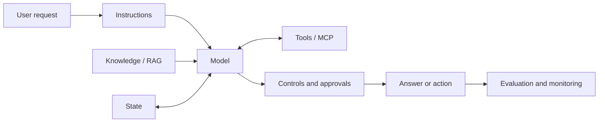
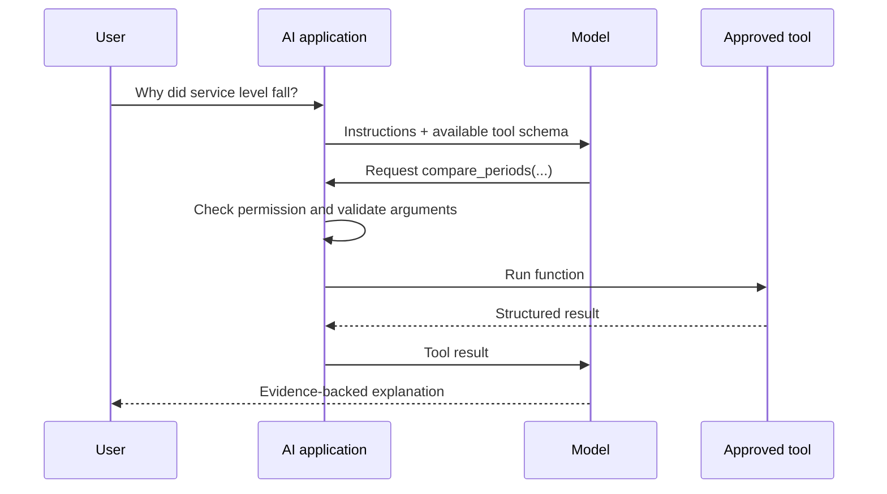
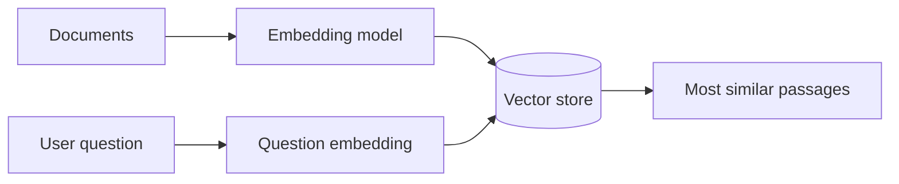
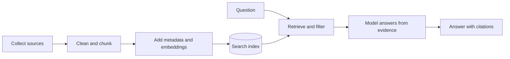
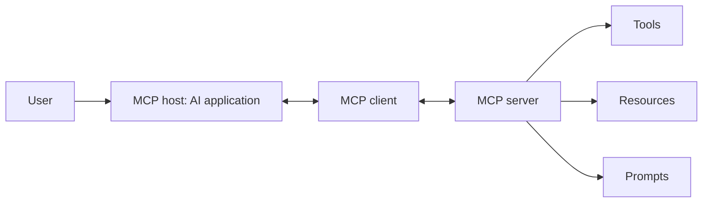
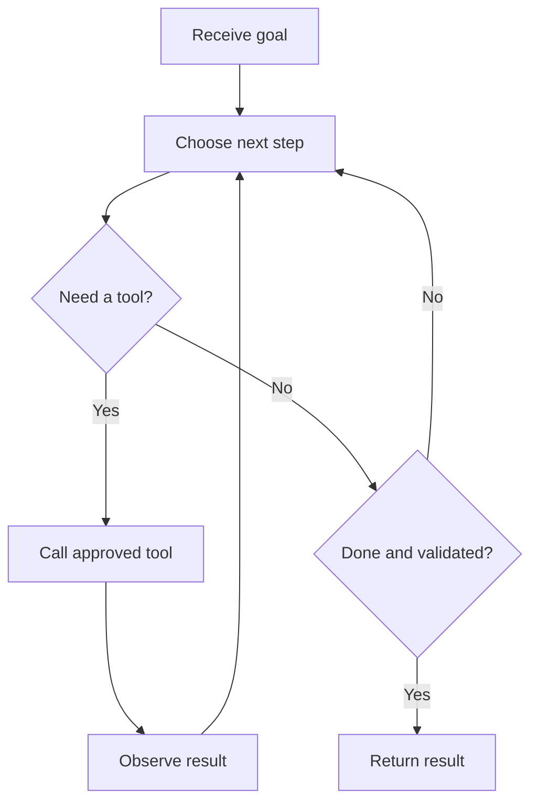
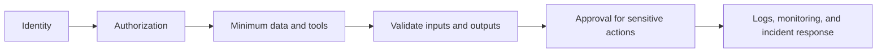

# Applied AI Study Guide

Use this as a self-contained reference for studying, interview preparation, and refreshing a concept on the go. It gives you enough depth to discuss the major ideas confidently without turning every section into a textbook.

> **How to use it:** Read one numbered section at a time. Study the diagram or example, review the bold terms, and answer the short “Can you explain it?” questions from memory.

### The walkthrough project: OpsAtlas AI

This guide uses **[OpsAtlas AI](https://github.com/kasteway/opsatlas-ai)** as one continuous example. It is a fictional customer-support operation with **synthetic data**. A leader asks, “Why did SLA attainment fall?” OpsAtlas calculates the KPI change, ranks region and issue-category contributions, retrieves relevant operating notes, and assembles a cited diagnostic brief. The short code excerpts below are from that repository, with explanations beside them, so you can study without keeping two pages open.

```text
Question → fixed coordinator → governed KPI calculations + local document retrieval
         → measured findings + cited context + hypotheses to validate
MCP server → separate read-only access to the same analytics calculations
```

**Know the boundary before an interview:** the published demo runs a fixed Python workflow. Its TF-IDF retriever is the *retrieval* part of a RAG design; it does not call an LLM to generate the final answer. Its MCP server exposes two real tools, but the offline coordinator calls the analytics object directly. The code shows where an AI client could connect; it does not claim a model currently chooses those tools. [Run the project](https://github.com/kasteway/opsatlas-ai#quick-start) or read its [project-specific guide](https://github.com/kasteway/opsatlas-ai/blob/main/STUDY_GUIDE.md) when you want more depth.

**Coverage key:** “Built” means runnable in OpsAtlas today; “next step” is a concept to learn, not a claimed feature.

| Guide topic | OpsAtlas connection |
|---|---|
| System, analytics, structured output | Built: fixed coordinator, governed KPI math, typed response |
| Models and prompting | Next step: no model call or prompt template in the offline demo |
| Embeddings and RAG | Built: lexical retrieval with citations; next step: embeddings and model-generated answer |
| MCP | Built: two read-only tools; the offline coordinator does not call them |
| Agent workflows | Built: fixed workflow; next step: model-chosen tool loop |
| Evaluation and governance | Built: tests, source citations, allowlisted metrics/dimensions; next step: full model eval and authentication |
| Production | Built: browser API and basic health route; next step: tracing, monitoring, access controls |

## Jump to a topic

1. [The central idea: an AI application is a system](#1-the-central-idea-an-ai-application-is-a-system)
2. [Models, providers, tokens, and context](#2-models-providers-tokens-and-context)
3. [Prompt and context engineering](#3-prompt-and-context-engineering)
4. [Structured outputs, APIs, and tools](#4-structured-outputs-apis-and-tools)
5. [Embeddings and vector search](#5-embeddings-and-vector-search)
6. [Retrieval-Augmented Generation (RAG)](#6-retrieval-augmented-generation-rag)
7. [Model Context Protocol (MCP)](#7-model-context-protocol-mcp)
8. [Agents and workflows](#8-agents-and-workflows)
9. [Evaluation](#9-evaluation)
10. [Security and governance](#10-security-and-governance)
11. [Production and observability](#11-production-and-observability)
12. [Career positioning and interview language](#12-career-positioning-and-interview-language)

---

## 1. The central idea: an AI application is a system

A model is the reasoning and language component of an AI application. The surrounding system determines what the model knows for the current task, what it is allowed to do, how its output is checked, and whether the result creates business value.



### The seven surrounding layers

| Layer | What it does | Operational analytics example |
|---|---|---|
| **Instructions** | Defines the goal, rules, audience, and output | “Compare current and prior period; identify only supported drivers.” |
| **Context** | Supplies the information available right now | Metric values, definitions, dates, regions, and user question |
| **Retrieval** | Finds relevant evidence from trusted knowledge | Retrieve the official service-level definition and policy |
| **Tools** | Gets live data, performs calculations, or takes actions | `compare_periods()` or `find_metric_drivers()` |
| **State** | Preserves task information across steps | Remember selected metric, period, and earlier findings |
| **Evaluation** | Measures whether the system works | Check driver accuracy, citations, latency, and usefulness |
| **Controls** | Enforces permissions and safe behavior | Read-only access, role checks, approval before sending reports |

### One request, step by step

Suppose a leader asks, “Why did our global service level fall?”

1. The application identifies the user and their data permissions.
2. Instructions tell the model how to analyze and present the result.
3. A tool retrieves the current and prior scorecards.
4. Retrieval supplies the official metric definition and known business rules.
5. The model compares regional and dimensional changes.
6. A structured result separates the driver, evidence, and confidence.
7. Evaluations or validation rules check the output before display.
8. The trace records which data, tools, and model version produced the answer.

### What people commonly misunderstand

- The model is **not a database**. Current or private information must be supplied.
- The model is **not an authorization system**. Software must enforce access.
- Fluent language is **not proof of correctness**. Evidence and evaluation are required.
- An agent is **not automatically better** than a fixed process. Use only the autonomy the task needs.

> **Remember:** AI quality depends on the whole system, not only the model.

**Can you explain it?** Why could the same model perform very differently in two applications?

**Main resources:** [OpenAI developer learning](https://developers.openai.com/learn/agents) · [OpenAI Agents guide](https://developers.openai.com/api/docs/guides/agents) · [NIST AI Risk Management Framework](https://www.nist.gov/itl/ai-risk-management-framework)

---

## 2. Models, providers, tokens, and context

### What a language model does

A large language model (LLM) predicts useful sequences of **tokens** based on patterns learned during training and the information in the current request. A token is a small unit of text—often part of a word, a complete short word, punctuation, or a number.

The model converts tokens into numeric representations, processes relationships among them, and generates output one token at a time. This can produce reasoning-like behavior, but it does not guarantee facts, calculations, or current knowledge.

### The major model families

Model names change quickly, so learn the providers and the shape of their model families. The table was reviewed against official provider pages in **October 2026**.

| Company | Main family to recognize | General strengths and positioning |
|---|---|---|
| **OpenAI** | GPT-5 family, specialized reasoning/coding, realtime, image, audio, and open-weight models | Broad general reasoning, coding, agents and tool use, multimodal work, structured outputs, and a large developer ecosystem |
| **Anthropic** | Claude Opus, Sonnet, and Haiku families | Opus emphasizes highest capability; Sonnet balances capability and efficiency; Haiku emphasizes speed and cost. Commonly used for analysis, long documents, coding, and agentic work |
| **Google DeepMind** | Gemini Pro, Flash, and Flash-Lite families | Strong multimodal capabilities and integration with the Google ecosystem; Pro targets harder tasks, Flash balances speed and quality, and Flash-Lite targets high-volume efficiency |
| **Meta** | Llama family | Open-weight models that organizations can download, adapt, and host; useful when deployment control, customization, or an open ecosystem matters |
| **Mistral AI** | Mistral Large, Medium, Small, and Ministral families | Commercial and open-weight options, efficient deployment, multilingual use, coding, agents, document AI, and smaller models |
| **xAI** | Grok family | General reasoning, coding, tools, and optional search integrations, including access to X search when explicitly enabled |

“Best model” always means **best for a particular task and constraint**. Compare candidates using your own evaluation set across:

- quality on representative tasks;
- latency and user experience;
- input and output cost;
- context-window needs;
- tool calling and structured-output reliability;
- text, image, audio, or video requirements;
- privacy, regional hosting, and vendor requirements;
- model stability and deprecation policy.

### Frontier, small, and open-weight models

- **Frontier models** prioritize the hardest reasoning, coding, and multimodal tasks. They are usually slower and more expensive.
- **Small or mini models** prioritize speed and cost for focused tasks such as classification, extraction, routing, and high-volume summaries.
- **Open-weight models** make model weights available under a license so an organization can host or adapt them. Open-weight does not always mean unrestricted open source; read the license.
- **Specialized models** focus on embeddings, speech, image generation, moderation, realtime interaction, or coding.

### Context window, output limit, and knowledge cutoff

These terms are related but different:

| Term | Meaning |
|---|---|
| **Context window** | Maximum tokens the model can consider in one request, including instructions, history, documents, tool results, and output allowance |
| **Output limit** | Maximum tokens the model can generate in its response |
| **Knowledge cutoff** | Approximate end of the model’s training knowledge; current facts still require search, retrieval, or tools |

Large context does not mean perfect recall. Important evidence can still be overlooked when surrounded by irrelevant material. Curate context and test performance at realistic lengths.

### Parameters you should recognize

- **Temperature:** adjusts variation in token selection. Lower values can improve consistency, but do not guarantee truth. Some newer reasoning models manage sampling internally.
- **Reasoning effort:** where supported, controls how much computation the model devotes before answering.
- **Max output tokens:** caps response length and cost.
- **Stop condition:** ends generation when a defined sequence or workflow condition is reached.

### OpsAtlas connection: no model is called yet

The offline project's [metric selector](https://github.com/kasteway/opsatlas-ai/blob/main/src/opsatlas/agent.py) uses simple Python rules:

```python
if "first contact" in lowered or "fcr" in lowered:
    return "first_contact_resolution"
if "escalat" in lowered:
    return "escalation_rate"
return "sla_attainment"
```

**What it does:** routes a question to one approved metric. **Why it matters:** there are no tokens, context-window decisions, temperature settings, or model costs in this run. If you add an LLM later, compare it against this rule-based baseline on ambiguous questions before claiming it improves routing.

### Simple model-selection example

Use a smaller model to classify a user request as “scorecard,” “policy,” or “forecast.” Use a stronger reasoning model only for ambiguous diagnosis. This routing can reduce cost and latency without lowering quality for simple cases.

> **Remember:** choose a model by measured task performance, not brand reputation or a single public benchmark.

**Can you explain it?** Why might a smaller model be the better production choice even if a frontier model scores higher overall?

**Current provider pages:** [OpenAI models](https://platform.openai.com/docs/models) · [Anthropic model documentation](https://docs.anthropic.com/en/docs/about-claude/models/overview) · [Google Gemini models](https://ai.google.dev/gemini-api/docs/models) · [Meta Llama](https://ai.meta.com/llama/) · [Mistral models](https://docs.mistral.ai/models/) · [xAI models](https://docs.x.ai/developers/models)

---

## 3. Prompt and context engineering

A **prompt** is the instruction and input sent to the model. **Context engineering** is the larger practice of deciding what the model sees at every stage: system rules, user input, history, retrieved evidence, tool results, examples, and state.

### A practical prompt structure

```text
ROLE: You are an operational analytics assistant.
TASK: Explain the current-period change in service level.
SOURCE RULE: Use only the supplied scorecard and metric definition.
METHOD: Compare global results, then regions, then available dimensions.
OUTPUT: Summary, top drivers, supporting evidence, confidence, follow-up.
BOUNDARY: If evidence is insufficient, say what data is missing.
```

Good prompts clarify:

- **Goal:** What decision or outcome should the response support?
- **Audience:** Executive, analyst, customer, or technical user?
- **Evidence:** Which information is authoritative?
- **Method:** Which comparisons or steps matter?
- **Format:** Narrative, table, or defined JSON schema?
- **Boundaries:** When should the model abstain or request more information?

### Zero-shot, few-shot, and templates

- **Zero-shot:** instructions without examples. Start here for clear tasks.
- **Few-shot:** include a small number of representative input-output examples when format or judgment is hard to describe.
- **Template:** reusable prompt with variables such as `{metric}`, `{period}`, and `{audience}`. Version templates like code.

### What context should be included?

Include information that changes the correct answer: definitions, time period, business rules, retrieved evidence, tool results, and relevant prior decisions. Summarize or remove repeated history and irrelevant documents.

**Weak:** “Analyze this dashboard and tell me what happened.”

**Stronger:** “Using only the supplied ten-metric scorecard, compare October with September. Rank the top three regional drivers by absolute contribution. Separate observed evidence from possible explanation. If contribution cannot be calculated, identify the missing fields.”

### OpsAtlas connection: a response contract before a prompt

OpsAtlas does not send the sample prompt above to a model. Its [response type](https://github.com/kasteway/opsatlas-ai/blob/main/src/opsatlas/models.py) makes the intended output distinction explicit:

```python
measured_findings: List[str]
hypotheses: List[str]
recommended_actions: List[str]
```

**What it does:** stores calculations, possible explanations, and next checks separately. **Why:** a later model prompt should preserve that separation rather than turn a staffing note into a proven cause. In this demo, Python fills these fields; prompt effectiveness and injection resistance have not been evaluated.

### Prompt injection versus ordinary prompting

Normal prompting comes from trusted application or user instructions. **Prompt injection** comes from untrusted content—such as a document or webpage—that attempts to change the system’s behavior. Labeling text as “ignore this” is not a complete defense; tools, permissions, and data access must be constrained outside the model.

> **Remember:** prompt engineering describes the task; context engineering supplies the right working information.

**Can you explain it?** Which parts of a diagnostic assistant’s context should change from one request to the next?

**Main resources:** [OpenAI prompt engineering](https://platform.openai.com/docs/guides/prompt-engineering) · [Anthropic prompting best practices](https://docs.anthropic.com/en/docs/build-with-claude/prompt-engineering/overview) · [Google prompt design strategies](https://ai.google.dev/gemini-api/docs/prompting-strategies)

---

## 4. Structured outputs, APIs, and tools

### Three concepts to separate

| Concept | Purpose | Example |
|---|---|---|
| **API** | Lets software systems exchange requests and responses | Request a current scorecard from a metrics service |
| **Structured output** | Makes model output follow a machine-readable schema | Return metric, driver, evidence, and confidence as JSON |
| **Tool calling** | Lets a model request an approved function | Ask to call `compare_periods(metric, region)` |



The model proposes a tool and arguments. The application decides whether the call is allowed, validates it, executes normal code, and returns the result.

### Example structured result

```json
{
  "metric": "service_level",
  "change_points": -3.1,
  "top_driver": {
    "dimension": "region",
    "value": "West",
    "change_points": -6.2
  },
  "evidence": ["West volume rose 18% while capacity rose 4%"],
  "confidence": "medium"
}
```

This result can be validated, displayed in an HTML dashboard, saved for audit, or passed to the next workflow step.

### From OpsAtlas: keep arithmetic in code

The published project uses a fixed Python workflow, so this is a normal function call rather than a model-selected tool call. The same calculation is also exposed through its MCP server in section 7.

```python
# src/opsatlas/analytics.py
    def compare_latest(self, metric: str) -> Dict:
        weeks = self.available_weeks()
        previous = self.metric_value(metric, weeks[-2])
        current = self.metric_value(metric, weeks[-1])
```

`metric_value()` applies an approved numerator and denominator. `compare_latest()` uses the two latest weeks, then returns a structured dictionary containing both values and their difference. **Why:** a language model should explain a checked calculation, not improvise the arithmetic. [See the full calculation](https://github.com/kasteway/opsatlas-ai/blob/main/src/opsatlas/analytics.py).

### Good tool design

- Give the tool one clear responsibility and a descriptive verb-based name.
- Define argument types, allowed values, formats, and required fields.
- Explain when the model should and should not use it.
- Return predictable success and error structures.
- Apply the user’s real permissions before execution.
- Start with read-only access and require approval for consequential actions.
- Log the caller, arguments, result status, timing, and data version.

> **Remember:** the model can recommend an action; controlled application code performs it.

**Can you explain it?** Why is structured output helpful even when the user ultimately sees a paragraph?

**Main resources:** [OpenAI tools](https://developers.openai.com/api/docs/guides/tools) · [OpenAI function calling](https://developers.openai.com/api/docs/guides/function-calling) · [JSON Schema](https://json-schema.org/learn/getting-started-step-by-step)

---

## 5. Embeddings and vector search

An **embedding** is a numeric representation of meaning. Texts with related meanings tend to have vectors located near one another, so the system can find conceptually relevant passages even when they use different words.



### Example

The question “Why did customers wait longer?” could retrieve a passage titled “Handle-time and staffing variance” even though the exact wording is different. Keyword search might miss that relationship; semantic search can recognize it.

### Terms to know

- **Vector:** the list of numbers representing an item.
- **Similarity:** a numeric estimate of how close two vectors are.
- **Vector store/database:** stores embeddings with the original content and metadata.
- **Metadata filter:** restricts results by fields such as region, effective date, owner, or access level.
- **Hybrid search:** combines semantic vector search with keyword or lexical search.
- **Reranking:** applies another model or scoring method to reorder initial results.

### OpsAtlas connection: keyword scoring, not embeddings

The [retriever](https://github.com/kasteway/opsatlas-ai/blob/main/src/opsatlas/retrieval.py) scores shared words in the question and each document section:

```python
tf = document_terms[term] / total
idf = math.log((1 + len(self.documents)) / (1 + self.document_frequency[term])) + 1
score += query_count * tf * idf
```

**What it does:** rewards terms that are frequent in one section but uncommon across all sections. **Why it matters:** this is transparent and works offline, but “customer wait” may miss a passage that only says “queue delay.” An embedding or hybrid index is a future comparison to test, not something OpsAtlas currently uses.

### What embeddings do not do

Embeddings do not determine whether a source is true, current, complete, or authorized. They only help find similarity. Source governance, metadata, and access control remain necessary.

> **Remember:** embeddings help locate meaning; they do not validate truth.

**Can you explain it?** When might hybrid search outperform vector search alone?

**Main resources:** [OpenAI embeddings](https://platform.openai.com/docs/guides/embeddings) · [Google embeddings](https://ai.google.dev/gemini-api/docs/embeddings) · [Pinecone vector database concepts](https://docs.pinecone.io/guides/get-started/overview)

---

## 6. Retrieval-Augmented Generation (RAG)

RAG searches a trusted knowledge collection at request time and supplies the most relevant passages to the model before it answers.



### The indexing stage

1. Select authoritative documents.
2. Extract and clean the text.
3. Split it into meaningful **chunks**.
4. Preserve source, section, date, ownership, and access metadata.
5. Create embeddings and store the chunks in a searchable index.

### The answering stage

1. Interpret or rewrite the question for search.
2. Apply access and metadata filters.
3. Retrieve candidate chunks.
4. Rerank when useful.
5. Ask the model to answer only from the evidence.
6. Cite the source and allow “not found” when evidence is missing.

### From OpsAtlas: retrieve the evidence

The complete RAG diagram above shows a model-generated answer. OpsAtlas currently implements the **local retrieval and citation** portion with Markdown notes and TF-IDF-style term matching; its offline brief is assembled by Python. It does not use embeddings or send the passages to an LLM.

```python
# src/opsatlas/retrieval.py
    def search(self, query: str, limit: int = 4) -> List[Citation]:
        ranked = sorted(
            ((self._score(query, text), source, section, text)
             for source, section, text in self.documents),
            reverse=True,
        )
        return [Citation(source, section, text[:280])
                for score, source, section, text in ranked[:limit] if score > 0]
```

**Read it in order:** `_score()` gives every section a relevance score; `sorted()` puts strong matches first; `[:limit]` keeps at most four; `Citation(...)` preserves the file and heading with a short excerpt. For the query “West Phoenix staffing,” the retrieval test expects `incident_log.md` first. **Why:** an analyst can inspect the supporting note instead of trusting an unsupported explanation. [See the retriever](https://github.com/kasteway/opsatlas-ai/blob/main/src/opsatlas/retrieval.py) and [its test](https://github.com/kasteway/opsatlas-ai/blob/main/tests/test_retrieval.py).

**Interview wording:** “I built an inspectable retrieval layer with source citations. Connecting those passages to a generative model would complete the generation stage of RAG; the offline demo intentionally stops short of that.”

### RAG versus fine-tuning

| Need | Better starting point |
|---|---|
| Current policies, internal documents, source citations | **RAG** |
| Consistent style, format, or repeated behavior | **Fine-tuning** or strong prompting |
| Live metrics or calculations | **Tools/API**, possibly combined with RAG |
| General task improvement | Start with prompting and model selection, then evaluate |

### Where RAG fails

- The source was never indexed or is outdated.
- Chunk boundaries separate the question from the answer.
- Search finds related text but misses the decisive passage.
- Access filters are missing or incorrect.
- The model adds unsupported information beyond the retrieved evidence.

Test **retrieval quality** separately from **answer quality**. If the correct source never reaches the model, changing the answer prompt may not fix the problem.

> **Remember:** retrieval selects the evidence; generation explains it.

**Can you explain it?** How would you determine whether a wrong answer was caused by retrieval or by generation?

**Main resources:** [OpenAI retrieval](https://platform.openai.com/docs/guides/retrieval) · [LangChain RAG tutorial](https://docs.langchain.com/oss/python/langchain/rag) · [Microsoft advanced RAG guidance](https://learn.microsoft.com/azure/developer/ai/advanced-retrieval-augmented-generation)

---

## 7. Model Context Protocol (MCP)

MCP is a standard way for AI applications to discover and use external capabilities. It reduces the need to build a completely different connector for every AI application and data service.



### The three roles

- **Host:** the AI application where the user works.
- **Client:** the connection inside the host that communicates using MCP.
- **Server:** the service exposing capabilities.

### What a server exposes

| Capability | Meaning | Analytics example |
|---|---|---|
| **Tool** | Function the model can request | `compare_periods()` or `find_metric_drivers()` |
| **Resource** | Readable context identified by a URI | Metric dictionary or current scorecard definition |
| **Prompt** | Reusable interaction template | “Create regional performance review” |

### From OpsAtlas: the entire MCP idea in a few lines

The real [OpsAtlas MCP server](https://github.com/kasteway/opsatlas-ai/blob/main/src/opsatlas/mcp_server.py) is intentionally small. It **does not contain the KPI formula**. It gives an MCP client a standard way to discover and request approved calculations that already live in `analytics.py`.

```python
# src/opsatlas/mcp_server.py
mcp = FastMCP("OpsAtlas Analytics")

@mcp.tool()
def compare_metric(metric: str) -> dict:
    return analytics.compare_latest(metric)

if __name__ == "__main__":
    mcp.run()
```

| Code | Plain-English job |
|---|---|
| `FastMCP(...)` | Creates the server and gives it a name. |
| `@mcp.tool()` | Registers `compare_metric` so a compatible client can discover it. |
| `metric: str` | Declares the argument the client must provide. |
| `analytics.compare_latest(metric)` | Calls ordinary Python that validates the metric and calculates the answer. |
| `mcp.run()` | Starts the local server when you run this file as a program. |

The second tool, `rank_drivers(metric, dimension, limit)`, follows the same pattern. Its dimension is checked against an allowlist in `analytics.py`. A client could request `compare_metric("sla_attainment")`. With the committed demo data, the underlying Python calculation returns:

```json
{"metric": "sla_attainment", "previous": 88.05, "current": 84.18, "change": -3.87}
```

That is a **3.87 percentage-point decline**, not a 3.87% relative decline. The actual dictionary also includes the two week dates. **MCP is the doorway; the analytics module is the calculation room.** The published server exposes tools only—not MCP resources or prompts. The offline coordinator does not call this MCP server; both paths reuse the same analytics logic.

**Interview wording:** “I wrapped validated, read-only KPI calculations as discoverable MCP tools. That lets a compatible AI client request a comparison without giving the model direct access to raw data or letting it invent the calculation.”

### MCP versus an API

An API is a general software interface. MCP is a protocol designed to make tools, resources, and prompts discoverable and usable by AI hosts. An MCP server often wraps existing APIs, databases, or files rather than replacing them.

### What MCP does not guarantee

MCP does not automatically provide trustworthy data, correct calculations, secure authorization, or safe tool behavior. Use trusted servers, explicit authentication, least privilege, tool allowlists, argument validation, approval controls, and audit logs.

> **Remember:** MCP standardizes the connection; governance controls the capability.

**Can you explain it?** When should a metric definition be an MCP resource rather than a tool?

**Main resources:** [Official MCP documentation](https://modelcontextprotocol.io/) · [OpenAI MCP guide](https://developers.openai.com/api/docs/guides/tools-connectors-mcp) · [MCP architecture](https://modelcontextprotocol.io/docs/learn/architecture)

---

## 8. Agents and workflows

An **agent** is a model operating in a loop with instructions, tools, and state. It chooses the next step based on what it discovers. A **workflow** follows steps chosen in advance.



### Choose the simplest reliable pattern

| Pattern | Use when | Example |
|---|---|---|
| **Single model call** | One transformation is enough | Summarize a supplied report |
| **Fixed workflow** | Steps and rules are already known | Retrieve → calculate → validate → format |
| **Single agent** | The next step depends on findings | Investigate which dimension explains a metric change |
| **Multiple agents** | Roles need separate tools, instructions, or quality boundaries | Metrics specialist hands evidence to executive-writing specialist |

### Core agent components

- **Instructions:** goal, operating rules, and boundaries.
- **Tools:** approved actions and information sources.
- **State:** task information preserved across steps.
- **Stopping condition:** definition of completion and turn/cost limits.
- **Trace:** record of decisions, model calls, and tool calls.
- **Human approval:** checkpoint before consequential actions.

### From OpsAtlas: a bounded coordinator, not a model loop

```python
# src/opsatlas/agent.py
        comparison = self.analytics.compare_latest(metric)
        region_drivers = self.analytics.drivers(metric, "region", 3)
        issue_drivers = self.analytics.drivers(metric, "issue_category", 3)
        evidence = self.retriever.search(question + " " + metric.replace("_", " "), 4)
```

The coordinator selects a metric with simple rules, then always performs these fixed steps. It combines **measured** KPI/driver results with **retrieved** context and writes hypotheses that need checking. This is a workflow prototype, even though the class is named `OpsAtlasAgent`. A true model-driven agent would choose its next tool call based on observed results, with limits and evaluation. [Read the full coordinator](https://github.com/kasteway/opsatlas-ai/blob/main/src/opsatlas/agent.py).

### A practical analytics agent

1. Retrieve the metric definition.
2. Call a scorecard tool for current and prior periods.
3. Compare global and regional performance.
4. Drill into the dimensions most likely to explain the change.
5. Distinguish observed drivers from hypotheses.
6. Produce a structured finding and executive summary.
7. Ask for approval before publishing or sending it.

Multi-agent systems create extra coordination, latency, cost, and failure points. Start with one agent and split roles only when evaluation shows a clear improvement.

> **Remember:** use autonomy where the path is uncertain; use fixed logic where the rules are known.

**Can you explain it?** Why might a fixed workflow around one small agent decision be safer than a fully autonomous agent?

**Main resources:** [OpenAI Agents guide](https://developers.openai.com/api/docs/guides/agents) · [OpenAI Agents SDK](https://developers.openai.com/api/docs/guides/agents/sdk) · [Anthropic building effective agents](https://www.anthropic.com/research/building-effective-agents)

---

## 9. Evaluation

Evaluation turns “the demo looked good” into repeatable evidence. A useful evaluation set contains realistic tasks, expected behavior, difficult cases, restricted requests, and known past failures.

### Evaluate every layer

| Layer | Example measure |
|---|---|
| **Data** | Freshness, completeness, valid ranges, correct grain |
| **Retrieval** | Correct evidence appears in the top results |
| **Tools** | Correct tool and valid arguments were selected |
| **Grounding** | Claims are supported by cited evidence |
| **Answer** | Correctness, completeness, clarity, usefulness |
| **Workflow** | Task completion, approval compliance, safe recovery |
| **Operations** | Latency, token usage, cost, errors, availability |

### From OpsAtlas: test the boundary that matters

```python
# tests/test_retrieval.py
results = KnowledgeRetriever(ROOT / "knowledge").search(
    "West Phoenix staffing schedule adherence"
)
self.assertEqual(results[0].source, "incident_log.md")
```

This test checks that a realistic question retrieves the intended source. Other project tests check KPI calculations and that the final response separates measured findings from hypotheses. These are narrower than a full model evaluation, but they give you repeatable proof of what the offline prototype actually does. [See the tests](https://github.com/kasteway/opsatlas-ai/tree/main/tests).

### Evaluator types

- **Code-based checks:** best for exact calculations, schemas, required citations, and tool arguments.
- **Human review:** best for business accuracy, usefulness, tone, and ambiguous judgment.
- **Model-based graders:** useful at scale for semantic qualities when given a clear rubric. Audit their decisions because graders can also be wrong.

### Example evaluation case

```text
Question: Why did global service level decline in October?
Expected evidence: West region contribution and staffing variance.
Expected tool: compare_periods, then find_metric_drivers.
Must not: invent causal claims or cite an unrelated policy.
Pass: correct direction, supported top driver, citation, and stated uncertainty.
```

Use the same set to compare prompts, retrieval settings, models, and tool descriptions. Add production failures back into the set as regression cases.

> **Remember:** evaluate the full result and the individual stage that may have failed.

**Can you explain it?** Why can a high average score still hide an unacceptable production risk?

**Main resources:** [OpenAI evaluation best practices](https://platform.openai.com/docs/guides/evaluation-best-practices) · [OpenAI evals](https://platform.openai.com/docs/guides/evals) · [LangSmith evaluation](https://docs.langchain.com/langsmith/evaluation-types)

---

## 10. Security and governance

AI security determines which data the system may access, which actions it may take, and how failures are contained. Governance establishes ownership, acceptable use, documentation, review, and accountability.

### Main risks to recognize

- **Prompt injection:** untrusted content attempts to override instructions or misuse tools.
- **Data leakage:** private information appears in prompts, logs, retrieval results, or outputs.
- **Excessive agency:** the system can take broader actions than the task requires.
- **Improper authorization:** a user retrieves information or runs a tool outside their role.
- **Supply-chain risk:** an external model, MCP server, package, or data source behaves unexpectedly.
- **Unsupported decisions:** users treat a plausible model response as verified evidence.

### Defense in depth



Do not ask the prompt to enforce a permission that code can enforce. The application should check identity and authorization before retrieving data or executing a tool.

### From OpsAtlas: enforce an allowlist in Python

The [analytics layer](https://github.com/kasteway/opsatlas-ai/blob/main/src/opsatlas/analytics.py) checks requested metrics and drill-down dimensions before calculating:

```python
if metric not in METRICS:
    raise AnalyticsError("Unknown metric: %s" % metric)
if dimension is not None and dimension not in ALLOWED_DIMENSIONS:
    raise AnalyticsError("Dimension is not approved: %s" % dimension)
```

**What it does:** rejects unknown metric names and dimensions even if a client asks for them. **Why:** a prompt saying “only use approved metrics” is weaker than a code check. The [test](https://github.com/kasteway/opsatlas-ai/blob/main/tests/test_analytics.py) confirms an unapproved dimension is rejected. This is a demo allowlist, **not** user authentication or role-based access control.

### Governance questions

1. Who owns the system and the underlying data?
2. Which uses are approved or prohibited?
3. Which sources and models are permitted?
4. What needs human review?
5. What is logged, who can view it, and how long is it retained?
6. How are quality, bias, incidents, and user complaints reviewed?

> **Remember:** authorization belongs in software controls, not in natural-language instructions.

**Can you explain it?** How does least privilege reduce the harm caused by prompt injection?

**Main resources:** [OpenAI safety best practices](https://platform.openai.com/docs/guides/safety-best-practices) · [OWASP Top 10 for LLM applications](https://genai.owasp.org/llm-top-10/) · [NIST AI RMF](https://www.nist.gov/itl/ai-risk-management-framework)

---

## 11. Production and observability

A prototype becomes a product when it works repeatedly for real users, failures are visible, changes are controlled, and the system produces measurable value.

### OpsAtlas connection: a health route is only a start

The browser-facing [FastAPI app](https://github.com/kasteway/opsatlas-ai/blob/main/src/opsatlas/api.py) includes:

```python
@app.get("/health")
def health():
    return {"status": "ok"}
```

**What it does:** tells a caller the process can answer a basic request. **What it cannot show:** whether source data is fresh, retrieval chose the right note, a diagnosis is correct, or users are actually helped. OpsAtlas has tests and a health route, but not production tracing, latency dashboards, alerting, or access controls. Those belong on its production roadmap.

### What to version

- model and configuration;
- instructions and prompt templates;
- tool definitions and schemas;
- retrieval sources and settings;
- evaluation data and rubrics;
- application code and deployment configuration.

### What a trace should show

A **trace** records the path of one request: input, retrieved sources, model calls, tool arguments and results, approvals, errors, final response, latency, and cost. Protect sensitive content and apply retention rules to traces.

### Three monitoring views

| View | Questions | Example measures |
|---|---|---|
| **Quality** | Is the output grounded and useful? | Citation support, tool accuracy, user rating |
| **Reliability** | Is the service healthy? | Latency, errors, availability, fallbacks, data freshness |
| **Value** | Is it improving the work? | Time to diagnosis, consistency, adoption, decisions supported |

### Measuring your operational analytics use case

Compare users completing the same representative diagnostic cases with the old and new process. The old process may require opening several Tableau workbooks, filtering dimensions, and manually connecting the evidence. The AI-assisted process combines the metrics in one view and explains likely drivers.

Measure:

- time to a **correct** diagnosis;
- percentage of cases with the correct top driver;
- number of manual workbook/filter steps;
- user confidence and ability to verify the evidence;
- cost per completed analysis;
- escalation rate when evidence is insufficient.

This produces a defensible value story without inventing a time-savings percentage.

> **Remember:** monitor model behavior, system health, and business impact.

**Can you explain it?** Why is “number of AI answers generated” weaker than “time to a correct diagnosis” as a success measure?

**Main resources:** [OpenAI Agents SDK tracing](https://openai.github.io/openai-agents-python/tracing/) · [LangSmith observability](https://docs.langchain.com/langsmith/observability-concepts) · [Google SRE monitoring concepts](https://sre.google/sre-book/monitoring-distributed-systems/)

---

## 12. Career positioning and interview language

### Your applied AI story

> I build governed analytics products that turn operational data into faster, evidence-backed decisions. I use Python and structured data layers, interactive dashboards, custom GPTs and agents, retrieval, and controlled tools to help users understand what changed, which dimensions drove it, and what evidence supports the conclusion.

This is applied AI because it combines business knowledge, data quality, analytics, model interaction, workflow design, evaluation, and adoption. Traditional machine learning remains valuable for forecasting, classification, anomaly detection, and scoring. Generative AI adds a natural-language reasoning and interaction layer around data, models, and tools.

### OpsAtlas interview story in 30 seconds

> “I built OpsAtlas as a safe, synthetic-data prototype for operational KPI diagnosis. Python calculates the change and ranks drivers; a local retriever brings in cited metric and incident context; a fixed coordinator separates measured findings from hypotheses. I also exposed two validated calculations through MCP. The current demo is intentionally offline and deterministic—an LLM narration layer, embeddings, authentication, and production monitoring are next steps to evaluate, not features I claim are already running.”

This is the project-specific version of your broader career story above. It lets you describe **what you built**, **why each component exists**, and **where you would go next** without overstating the code.

### Quick interview distinctions

| Term | Confident short explanation |
|---|---|
| **Foundation model** | Broad model trained on large datasets and adaptable to many tasks |
| **LLM** | Foundation model focused on understanding and generating language |
| **Multimodal model** | Works across more than one type of input or output, such as text and images |
| **Prompt** | Instructions and input for a model |
| **Context** | Everything available to the model for the current task |
| **Embedding** | Numeric representation used to compare semantic meaning |
| **RAG** | Retrieve relevant evidence first, then generate an answer from it |
| **Tool calling** | Model requests that application code run a defined function |
| **MCP** | Standard interface for exposing tools, resources, and prompts to AI hosts |
| **Agent** | Model-driven loop that chooses steps and tools |
| **Workflow** | Predetermined sequence of steps and rules |
| **Evaluation** | Repeatable measurement of system behavior and quality |
| **Guardrail** | Control that constrains, checks, routes, or blocks behavior |
| **Trace** | Record of the model, retrieval, tool, and approval steps in a run |

### Five interview answers worth practicing

1. **How do you choose a model?** “I start with task requirements, then compare quality, latency, cost, tool reliability, modalities, and governance using a representative evaluation set.”
2. **When would you use RAG?** “When answers depend on changing or private knowledge and users need source evidence.”
3. **When would you use an agent?** “When the next step depends on what the system discovers; otherwise I prefer a simpler fixed workflow.”
4. **How do you reduce hallucinations?** “Ground responses in trusted evidence, use tools for facts and calculations, require structured outputs where useful, allow abstention, and evaluate supported claims.”
5. **How do you prove value?** “I measure a business outcome such as time to a correct diagnosis, alongside quality, reliability, adoption, and cost.”

## Final self-check

You are ready to discuss the guide when you can explain:

1. Why the model is only one layer of an AI application.
2. How model families trade capability for speed, cost, and control.
3. The difference between a prompt and complete context.
4. The difference among structured output, an API, and tool calling.
5. How embeddings, retrieval, and generation work together.
6. How MCP differs from an ordinary API.
7. When to use a workflow, one agent, or multiple agents.
8. How to isolate and measure failures at each system layer.
9. Why permissions must be enforced outside the model.
10. How to connect AI quality to an operational business outcome.

## Reference shelf

- [OpenAI developer documentation](https://developers.openai.com/)
- [Anthropic Claude documentation](https://docs.anthropic.com/)
- [Google Gemini API documentation](https://ai.google.dev/gemini-api/docs)
- [Meta Llama documentation](https://ai.meta.com/llama/)
- [Mistral documentation](https://docs.mistral.ai/)
- [xAI developer documentation](https://docs.x.ai/)
- [Model Context Protocol](https://modelcontextprotocol.io/)
- [LangChain learning resources](https://docs.langchain.com/oss/python/learn)
- [LangSmith evaluation concepts](https://docs.langchain.com/langsmith/evaluation-types)
- [OWASP GenAI security guidance](https://genai.owasp.org/)
- [NIST AI Risk Management Framework](https://www.nist.gov/itl/ai-risk-management-framework)
