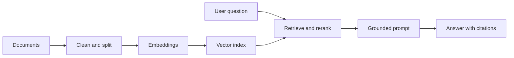

# Module 2: Retrieval-Augmented Generation

## Plain-language overview

RAG searches trusted information before asking the model to answer. It is useful when knowledge changes, belongs to an organization, or must be cited.

## Mental model

Imagine an open-book exam: retrieval selects the pages placed on the desk, and the model writes an answer from those pages. If the right page is missing, even a capable model may answer poorly.

## Goal

Answer questions from trusted information and show the evidence behind each answer.

## System flow

## Learn

- Document parsing and metadata
- Chunking tradeoffs
- Embeddings and similarity
- Vector and hybrid search
- Metadata filters and access control
- Query rewriting and reranking
- Citations, groundedness, and “not found” behavior

## Build

Create an Operational Policy Assistant using public aviation or financial-regulation documents. Each answer must include source title, section, and link.

## Evaluate

- Did retrieval contain the needed evidence?
- Was the cited passage relevant?
- Did the response stay within the evidence?
- Did the system abstain when evidence was missing?
- Did access filters exclude restricted documents?

## Common failure modes

- Chunks are too large or too small.
- Metadata is missing or inconsistent.
- Retrieval finds related text but not the answer.
- The model answers from general knowledge instead of evidence.
- Updated documents are not reindexed.

## RAG versus fine-tuning

Use RAG to supply changing facts and source evidence. Use fine-tuning mainly to reinforce repeated behavior, format, or style. Many applications need RAG without fine-tuning.

## Review questions

1. Why should retrieval quality and answer quality be measured separately?
2. What metadata would an internal policy assistant need?
3. When should the system answer “not found”?
4. How can chunk size change retrieval results?

## References

- [OpenAI retrieval guide](https://platform.openai.com/docs/guides/retrieval)
- [OpenAI embeddings guide](https://platform.openai.com/docs/guides/embeddings)
- [LangChain RAG tutorial](https://docs.langchain.com/oss/python/langchain/rag)
