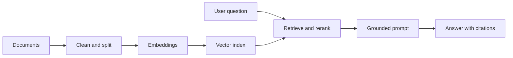

# Module 2: Retrieval-Augmented Generation

## Goal

Answer questions from trusted information and show the evidence behind each answer.

## System flow

## Learn

- Document parsing and metadata
- Chunking tradeoffs
- Embeddings and similarity
- Vector and hybrid search
- Metadata filters and access control
- Query rewriting and reranking
- Citations, groundedness, and “not found” behavior

## Build

Create an Operational Policy Assistant using public aviation or financial-regulation documents. Each answer must include source title, section, and link.

## Evaluate

- Did retrieval contain the needed evidence?
- Was the cited passage relevant?
- Did the response stay within the evidence?
- Did the system abstain when evidence was missing?
- Did access filters exclude restricted documents?

## Common failure modes

- Chunks are too large or too small.
- Metadata is missing or inconsistent.
- Retrieval finds related text but not the answer.
- The model answers from general knowledge instead of evidence.
- Updated documents are not reindexed.

